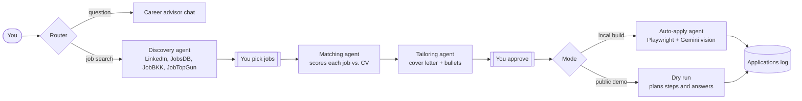
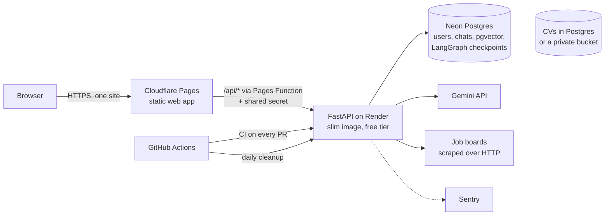

# Job Finder: an agentic AI job search assistant

[](https://github.com/Sauciiees/AgenticAI-JobFinder/actions/workflows/ci.yml?query=branch%3Achore/phase-1-cleanup)

A multi-agent assistant that searches four Thai job boards (LinkedIn, JobsDB, JobBKK, JobTopGun), scores each role against your CV, drafts a
tailored cover letter and resume bullets, and (in the local full build) signs in to the boards and applies in a real browser.
Built with **LangGraph**, **Gemini**, **FastAPI** and **Postgres + pgvector**.

**Live demo:** https://agenticai-jobfinder.saucesage009.workers.dev. Click **Try it as a guest** for a ready-made
account with a sample CV. **Auto-apply video:** _add your video link here_.

| Sign in or try as a guest | Live jobs from the boards |
|---|---|
|  |  |
| **Scored against your CV, with tailored materials** | **Auto-apply dry run in the demo** |
|  |  |

## How it works

The agent is a LangGraph state machine with two human checkpoints: you pick the jobs, and you
approve the drafted application before anything is sent.



CV text is split into chunks and embedded with Gemini. The matching and tailoring agents retrieve
the chunks most relevant to each job (pgvector cosine search) so they quote your real experience.

## Architecture



| Concern | How it's handled |
|---|---|
| Auth | bcrypt passwords, JWT in an `httpOnly`, `Secure`, `SameSite=Strict` cookie, CSRF double-submit, per-user token key (logout signs out everywhere) |
| Abuse | Cloudflare Turnstile on sign-up and guests; rate limits and daily quotas counted in Postgres (10 agent runs per user, 60 overall) |
| Privacy | CVs stored privately (in Postgres, or a private bucket with short-lived signed links), never as public files; guests deleted after 24 h, CVs and idle chats after 30 days; one-click account deletion |
| Hardening | The API only answers requests from the proxy; CSP and security headers; uploads checked by content (PDF/DOCX), size-capped, parsed before storing |
| Reliability | Alembic migrations run before each start; deploys only after CI passes; Sentry on both ends; "waking up" screen for the free tier's cold start |
| Cost | $0: Render, Neon and Cloudflare Pages free tiers (Turnstile, Sentry optional). The API uses about 150 MB of Render's 512 MB |

## Two builds from one codebase

The **local full build is the complete product**. The public demo is the same code with
browser automation switched off (`ENABLE_BROWSER_AUTOMATION`), so anyone can try it safely
without handing over job-board logins.

| Feature | Local full build | Public demo |
|---|---|---|
| Search LinkedIn, JobsDB, JobBKK, JobTopGun | ✅ | ✅ |
| Match scores, cover letters, resume bullets from your CV | ✅ | ✅ |
| Career-advice chat over your CV | ✅ | ✅ |
| Job-board sign-in (Profile) | ✅ Sign in once per board in a real browser window | 🔒 Shown but locked |
| Auto-apply | ✅ **Real**: Playwright + Gemini vision fill and submit the form | Dry run: plans the steps and answers, submits nothing |
| Daily quotas | Off | 10 agent runs per user, 60 overall |
| Where your data lives | Your machine only (SQLite or local Postgres) | Neon Postgres, guests deleted after 24 h |

- **Local full build** (`python scripts/dev.py --automation`, or `backend.dockerfile` +
  `docker compose` with a noVNC browser view): job-board sign-in in a visible browser and real
  auto-apply. Job-board sessions are kept per user under `browser_profile/` and never leave the
  machine.
- **Public demo** (`api.dockerfile`): no browser. All four boards' search pages and job pages
  are scraped over plain HTTP; auto-apply runs as a dry run; the sign-in endpoints return 404.

## Run it locally

```bash
python -m venv .venv
.venv\Scripts\activate            # macOS/Linux: source .venv/bin/activate
pip install -r requirements-dev.txt
copy .env.example .env            # then fill in GOOGLE_API_KEY and JWT_SECRET_KEY
python scripts/dev.py             # http://localhost:8000, demo mode, SQLite
```

Full build with job-board sign-in and real auto-apply, without Docker (the sign-in and
auto-apply windows open on your desktop):

```bash
pip install -r requirements-automation.txt
playwright install chromium
python scripts/dev.py --automation
```

Or the same full build in Docker:

```bash
docker compose up --build         # http://localhost:8000, browser view at http://localhost:6080
```

See [docs/TESTING.md](docs/TESTING.md) for a walkthrough and [docs/DEPLOY.md](docs/DEPLOY.md) to
put it online for free.

## Tests

```bash
pytest                            # SQLite
TEST_POSTGRES=1 pytest            # embedded Postgres 16 + pgvector, no Docker needed
ruff check . && mypy
```

99 tests cover auth and CSRF, rate limits and quotas, uploads, data isolation between users,
retention, the proxy checks, and the whole agent pipeline with a fake LLM. CI runs them on SQLite
and on a pgvector Postgres container.

## Project layout

```
server.py            FastAPI app: auth, agent endpoints, guests, quotas, retention
agent/               LangGraph graph, agent nodes, CV parsing, vector store
tools/               job-board search, scraping, Playwright auto-apply (local build)
config.py            every setting, from the environment
models.py            SQLAlchemy models;  migrations/  Alembic
auth.py limits.py retention.py storage.py demo.py
frontend/            the web app (vanilla JS), _headers for Cloudflare Pages
functions/api/       Cloudflare Pages Function that proxies /api to Render
api.dockerfile       slim public image;  backend.dockerfile  full local image
render.yaml          Render blueprint;  .github/workflows  CI and daily cleanup
```

## Notes

- LinkedIn's terms forbid automated applying. Real auto-apply runs only in the local build, on
  the owner's own accounts.
- The demo persona "Alex Demo" and the sample applications are fictional.
